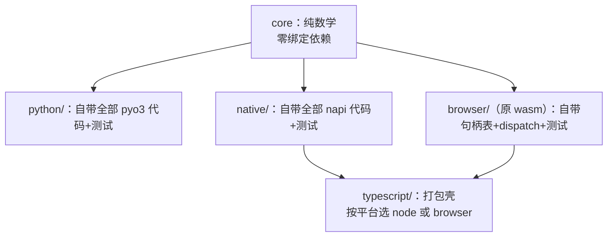

# 工程独立化重构（未执行，待拍板）

## 1. 问题：三套绑定都在往 core 塞代码（不止 wasm）

core 是纯数学库，但 python/node/wasm 三套绑定都有绑定代码住在 core 里。
实证（2026-11-22）：

| 污染源                          | 证据                                                                                                     | 规模      |
| ------------------------------- | -------------------------------------------------------------------------------------------------------- | --------- |
| core 挂绑定依赖                 | `core/Cargo.toml`：pyo3、napi、wasm-bindgen、js-sys、web-sys 全是 core 的 optional 依赖                  | 6+ 绑定库 |
| wasm 句柄表 + start 钩子在 core | `core/src/resources.rs`（255 行整文件）、`lib.rs` 的 `#[wasm_bindgen(start)] register_resources()`       | ~300 行   |
| wasm 字符串 dispatch 在 core    | `frequency.rs`/`touchstone.rs` 的 `call_namespace` + `register()`（手写字符串 `match`）                  | ~200 行   |
| wasm 的测试被迫住在 core        | `core/tests/resources_table.rs`（156 行，`#![cfg(feature = "browser", ...)]`），不能独立执行             | 156 行    |
| pyclass/napi 属性散布 core 类型 | `frequency.rs` 的 `#[cfg_attr(feature = "python", pyclass)]`、`#[cfg_attr(feature = "node", napi)]` 多处 | 全文件    |
| wasm 覆盖率驱动入口在 core      | `core/Cargo.toml` 的 `cov-drive` feature                                                                 | —         |

病症实证：`core/src/lib.rs` 注释自述 node 与 browser feature 在 clippy 下
合并成一个 build，每个绑定属性都得写 `not(feature = "node")` 互斥守卫——
绑定之间在 core 里互相打架。

对照目标「每个项目自我完整」：python/node 已有 newtype 包装但属性仍穿透
core；wasm 完全无包装，是重灾区。

## 2. 为什么现状的理由不成立（numpy 类比）

旧辩护：「dispatch 放 core，加方法只改一处，避免同步地狱」。**错**——

- numpy 改函数名，下游调用方必须跟着改，这是分层依赖的正常代价，由编译器
  兜底；没有下游为逃避改名而把代码塞进 numpy。
- wasm 的字符串 `match`（`"npoints" => ...`）匹配的是运行时数据里的字符串，
  **编译器根本不检查**：core 改了名，wasm 的字符串 arm 静默对不上、运行时才炸。
  即「放 core」既污染上游，又没换来它想换的编译期安全。

正确标准：下游只依赖上游的公开 API，绝不反向把代码放进上游；改名耦合交给
编译器强制（= python/node 的 newtype 委托）。

## 3. 目标架构（大白话）

依赖只许单向向下；core 里不再出现任何 pyo3/napi/wasm_bindgen 符号：

改名 wasm→browser：core 的 feature 名本就叫 `browser`，
`typescript/test/browser/`、`index.browser.ts` 已是这个词汇；只剩 crate 名
`netwave-wasm`、目录 `typescript/wasm/`、`test:wasm` 等命令没跟上。

## 4. 分阶段迁移（每段独立验证、独立回滚）

首轮最小增量 = 阶段 A。C 是超出本 Plan 原范围的新增块——python/node
也要纯，必须做 C 才成立。

| 阶段 | 做什么                                                                                                                                 | 验证标准                                                               |
| ---- | -------------------------------------------------------------------------------------------------------------------------------------- | ---------------------------------------------------------------------- |
| A    | `resources.rs`、start 钩子、两处 `call_namespace`/`register()` 从 core 搬进 wasm crate；wasm 改 newtype 委托直调 core pub 方法         | `pnpm test:wasm` 全绿；core grep 不到 `wasm_bindgen`                   |
| B    | `core/tests/resources_table.rs`、`cov-drive` 入口随迁 wasm crate                                                                       | core 测试不再需 `--features browser`；wasm 覆盖率链 `.ll` 路径同步     |
| C    | core 类型上的 pyclass/napi `cfg_attr` 全删，枚举/模块函数改由 python/native 各自 newtype 导出；core 的绑定依赖全删                     | `cargo tree -p netwave` 只剩 num-complex/strum/thiserror；三链独立可跑 |
| D    | 改名：`typescript/wasm/`→`typescript/browser/`，crate `netwave-wasm`→`netwave-browser`，脚本/命令/vitest 配置跟进                      | `pnpm test` 全链绿                                                     |
| E    | typescript 拆 native、browser 两个独立 pnpm 包（各自 package.json/test），顶层 `typescript/` 变发布壳：按平台条件导入 + 可整体发包 npm | tsdown 双产物、vitest 两包各自独立跑                                   |

worker generic dispatch 不变式（worker JS 零状态、不认识动词）随 A 重述：
「动词名表」从 core 移到 wasm/browser crate，worker JS 仍零状态。

## 5. 第二个独立问题：读全局单例不可 mock（与放置正交）

`core/src/touchstone.rs` 的 `fetch_text` 直接调 `js_sys::global()`，无参数入口
→ 「无 fetch scope」臂（547-550）任何 mock 都进不去。**搬 crate 不解决**——
要可 mock 需依赖注入：把 global 做成参数传入，生产传 `js_sys::global()`、
测试传假 global。这是设计改动，独立于第 4 节。

## 6. 待拍板清单（下次讨论逐项定）

- [ ] `resources.rs` 归属：进 wasm/browser crate 还是中立 `wasm-runtime`
      crate？（agent 倾向直接进 browser crate——只有一个消费者，抽 crate
      是没要求的抽象。）
- [ ] npm 发包形态（阶段 E）：发一个包（平台条件导入），还是 native/browser
      两个包 + 一个壳包？决定拆包深度。
- [ ] `fetch_text` 依赖注入（第 5 节，wasm 覆盖率 99→100 前置）是否并入
      本次重构一起做。
- [ ] 注册钩子搬迁后，`#[wasm_bindgen(start)]` 放哪、core 是否还含任何
      wasm 符号。
- [ ] worker generic dispatch / single-resident 不变式在 api-contract spec
      的措辞如何随放置迁移同步（LL-034）。
- [ ] `fetch_text` 依赖注入的签名与波及（native 侧 fetch 后端是否同改）。
- [ ] 三套绑定放置一致性写进哪条 spec/不变式（防再次漂移）。

## 7. 波及面（重构时必同步，勿漏）

- spec：`api-contract`（worker generic dispatch）、`ci-matrix`（覆盖率采集
  口径若随 crate 边界变化）。
- 不变式：worker 零状态、加方法改一处、绑定 crate 独立度量。
- 测试：wasm 覆盖率链的 `.ll` 源文件匹配（现按 `core/src/*.rs` grep，dispatch
  搬走后命中文件集合变）。
- 根配置：`Cargo.toml` workspace members、根 `package.json` 的 `test:wasm`
  等命令名、`pnpm-workspace.yaml`、`scripts/run/test_wasm.sh`/`test_ts.sh`、
  `coverage_gate.py` 文件匹配、`check_ci.py`。

## 8. 目标：wasm rust 覆盖率 99% → 100%

现状：wasm rust 地板为 99（非 100），唯一缺口是 `core/src/touchstone.rs`
的 `fetch_text`「无 fetch-capable scope」臂（读 `js_sys::global()` 真实全局、
无参数注入点，任何测试或 mock 均不可达）——见第 5 节。其余链（core/python/
node）均维持 100 地板，wasm 是唯一例外。

目标：补到 100%，让 wasm 与其他链同地板，消除这个例外。

前置（强绑定第 5 节）：先做 `fetch_text` 依赖注入——把 global 做成参数传入，
生产传 `js_sys::global()`、测试传假 global（无 fetch 能力的 scope），使该臂
可被单测驱动命中。搬 crate（第 4 节阶段 A）不解决此项，必须靠依赖注入。

落地时同步（勿漏，LL-034）：

- `scripts/run/test_wasm.sh`：`coverage_gate.py ... 99` → `100`。
- spec `ci-matrix`（铁律七 body + 豁免 scenario）与承载 change 的 delta：
  三处 `99` → `100`，删除「fetch 臂真不可达故地板 99」的豁免理由。
- proposal `已定裁决` 的 `wasm地板99`：随目标达成撤销或改写为 `wasm地板100`。
- 账本：99 地板的由来条目（fetch 臂不可达）标注已被依赖注入消解。

验证：`pnpm test:wasm` 全链 exit 0，且 coverage_gate.py 对
coverage/coverage-wasm.lcov 以地板 100 阅卷通过；本机 aarch64 可端到端验证
（不依赖 x86 格）。
