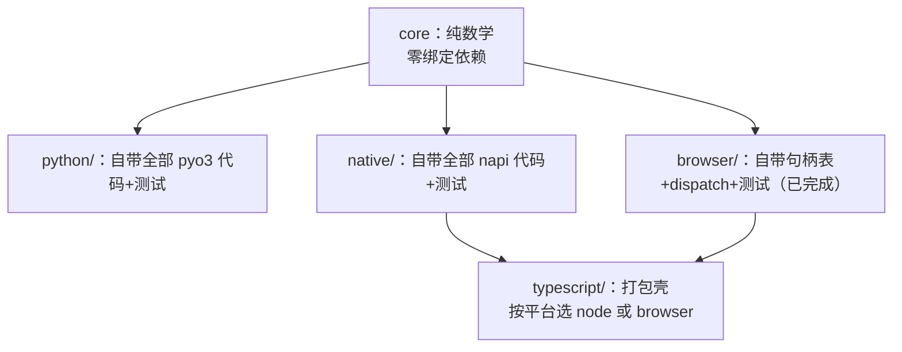

# 工程独立化重构（wasm/python 侧已执行，node 侧待拍板）

> 已完成：change `extract-browser-package`（2026-11-22）——wasm 抽成顶层
> `browser/` 包、改名 wasm→browser（crate/目录/命令/CI job）、typescript
> 回归 node + 构建期合并发布壳。change `extract-browser-bindings`——
> `resources.rs` 句柄表、start 钩子、两处 `call_namespace`/`register()`
> 从 core 搬进 browser crate；wasm 改 newtype 委托直调 core pub 方法；
> `core/tests/resources_table.rs`、覆盖率驱动入口随迁 browser crate；
> `fetch_text` 依赖注入（global 做成参数）落地，wasm rust 覆盖率地板
> 99→100；core 的 wasm-bindgen/js-sys/web-sys/wasm-bindgen-futures 依赖
> 与 browser/browser-http/cov-drive feature 全删。change
> `extract-python-bindings`——core 的 pyo3/pyo3-stub-gen 依赖与 python/
> pyo3-stub-gen feature 全删，`frequency.rs` 的 python cfg_attr 属性全清；
> python 枚举 pyclass 改由 `python/build.rs` 构建期机械生成，测试/构建入口
> 搬进 `python/scripts/`。以下只列**未执行项**。

## 1. 问题：node 绑定仍往 core 塞代码

core 现为纯数学库（wasm/python 侧已清零），但 node 绑定仍有绑定代码
住在 core 里。实证：

| 污染源                  | 证据                                                         | 规模     |
| ----------------------- | ------------------------------------------------------------ | -------- |
| core 挂绑定依赖         | `core/Cargo.toml`：napi 仍是 core 的 optional 依赖           | 1 绑定库 |
| napi 属性散布 core 类型 | `frequency.rs` 的 `#[cfg_attr(feature = "node", napi)]` 多处 | 全文件   |

病症：node 与 browser feature 在 clippy 下合并成一个 build，每个绑定属性都得
写 `not(feature = "node")` 互斥守卫——绑定之间在 core 里互相打架。

对照目标「每个项目自我完整」：node 已有 newtype 包装但属性仍穿透 core。

## 2. 为什么现状的理由不成立（numpy 类比）

旧辩护：「dispatch 放 core，加方法只改一处，避免同步地狱」。**错**——

- numpy 改函数名，下游调用方必须跟着改，这是分层依赖的正常代价，由编译器
  兜底；没有下游为逃避改名而把代码塞进 numpy。
- 字符串 `match`（`"npoints" => ...`）匹配的是运行时数据里的字符串，
  **编译器根本不检查**：core 改了名，字符串 arm 静默对不上、运行时才炸。
  即「放 core」既污染上游，又没换来它想换的编译期安全。

正确标准：下游只依赖上游的公开 API，绝不反向把代码放进上游；改名耦合交给
编译器强制（= python/node 的 newtype 委托）。

## 3. 目标架构（大白话）

依赖只许单向向下；core 里不再出现任何 pyo3/napi 符号（wasm_bindgen 已清零）：

## 4. 未执行阶段（每段独立验证、独立回滚）

| 阶段 | 做什么                                                                                                     | 验证标准                                                               |
| ---- | ---------------------------------------------------------------------------------------------------------- | ---------------------------------------------------------------------- |
| C    | core 类型上的 napi `cfg_attr` 全删，枚举/模块函数改由 native 各自 newtype 导出；core 的 napi 依赖全删      | `cargo tree -p netwave` 只剩 num-complex/strum/thiserror；三链独立可跑 |
| F    | vitest 三配置 functions/statements 阈值补齐到四维全 100（原 `覆盖率统一` S6，详见第 5 节）——布局定形后收尾 | 逐配置 `--coverage` 到 100 即钉；到不了按 LL-020 标 `/* v8 ignore */`  |

阶段 F（S6）排在 C 之后：它钉的是各端 vitest 配置的阈值，绑定搬迁会改变覆盖率
分母命中的文件集合——先钉则同一批配置改两遍、分母随代码归属变化而失效。

## 5. vitest 三配置阈值补齐（原 `覆盖率统一` S6，并入本 Plan）

来源：change `unify-coverage-gates`（2026-11-14 归档，结论唯一真相源为
[ci-matrix spec](../openspec/specs/ci-matrix/spec.md)）遗留的延后项，随本
重构一并完成。

- 现状口径不一致（thresholds 维度）：native = lines+branches；wasm =
  lines+branches+functions；browser = 全四维。spec（ci-matrix）只强制
  `lines: 100`，functions/statements 非 spec 要求。
- 目标：三配置统一补齐到 lines+branches+functions+statements 全 100——
  native 补 functions+statements，wasm 补 statements，browser 已全。真正
  要改的是 native 与 wasm 两端（browser 已满）。
- 验证：逐配置跑 `pnpm -C typescript test:<端> --coverage`，到 100 即钉；
  到不了 = 有结构性命中不到的函数/语句，按 LL-020 逐条 `/* v8 ignore */`
  标注豁免并附理由，禁硬编码行号。
- 波及面：若补齐后口径变化，同步核对 ci-matrix spec 覆盖率条款是否需把
  functions/statements 写进地板（当前只写 lines）。
- 排序：作为阶段 F，排在 C 之后（见第 4 节）——布局定形后再钉，避免
  改名/拆包导致同一批配置改两遍、覆盖率分母随文件归属漂移。

## 6. 待拍板清单（下次讨论逐项定）

- [ ] python/node 绑定放置一致性写进哪条 spec/不变式（防再次漂移）。
