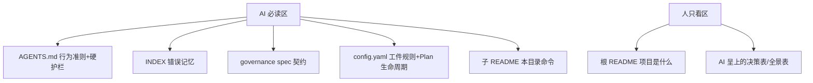

# Design

## Context

本 change 是文档治理重构，不改产品代码。设计对象是"规矩文档体系"本身：
`AGENTS.md`（AI 行为准则，每次会话全量注入）、`CONTRIBUTING.md`（原定位
"developer-facing"）、`openspec/specs/project-governance/spec.md`（宪法）、
`openspec/config.yaml`（openspec 工件规则与流程钩子）、lessons-learned 账本
（AI 长期错误记忆）、`Plan/`（未执行任务）。

约束来源：治理 spec 元规则「优先级与单一真相源」「文档受众分层」
（本次要改它）、「代码只写使用信息」，以及门禁脚本
`check_md.py` / `check_comments.py` / `check_proposal.py` 零豁免扫描全仓。

## Decisions

以下为本 change 立案的已定裁决（会话拍板，以裁决内容命名，不用临时序号）。

- **动词 = 授权全集**：只执行人明确点名的动作；未点名的改文件/建文件/
  删文件/commit 一律禁止。落 `AGENTS.md` 硬护栏。
- **"研究 / 探讨 / 该不该"类只出文字**：此类题目只给答案与原因，动手即越权。
  事故证据见账本 LL-070。
- **"实施" ≠ 改代码**：指执行此前讨论定下的动作，定的是改文档就改文档。
- **已定裁决 = 已获授权**：直接执行，不重复确认。
- **闸门自动执行**：spec/AGENTS.md 规定必做的 `pnpm check`、`pnpm check:md`、
  测试、波及面同步，题目没点名也必须跑。
- **不确定必须问**：语义歧义或会动 spec/公开 API/数据布局时必须问人；
  提问不需要口令（提问不改动任何东西）。
- **找事实归 agent，拍板归人**。
- **受众 = AI**：全部规矩文档人不读不写。推翻原「受众分层」里
  "面向开发人类"的前提。
- **人的职责 = 决策方向 + 点名执行**，其余细节全归 AI。
- **CONTRIBUTING 降级为薄门面**（不整文件废除）：留目录一览 + 人可能
  亲手敲的命令速查。理由：人偶尔亲手跑命令的场景真实存在，30 行速查比
  没有强；外部贡献者近零，不需要完整人类文档。
- **review 三轴归 governance spec 的元规则段**（不占铁律编号）。理由：
  铁律号 = 产品契约（数据/API/CI），元规则 = 治理流程；三轴是"怎么检查"，
  属后者。强制力靠 Scenario 写死，不靠编号位置。
- **Plan/ 生命周期唯一正文 = `openspec/config.yaml`**。理由：规则正文
  跟着执行钩子走（apply/archive 时自动注入），注入链最短；AGENTS.md 那节
  是纯副本。
- **文档书写规范退役**：锚点/禁日期/链接规则已由 `check_md.py` +
  markdownlint 机检，常驻文档只留"改 md 必过 `pnpm check:md`"一句。
  这是既有"可门禁化的文字规则退役"原则的兑现。
- **缓办事项入 Plan/**：INDEX 退役审计新建 `Plan/账本退役审计.md`
  （新话题新文件），`方案讨论纪律.md` 的 8 项细节留原文件（话题未变不搬家）。
- **硬护栏现在收敛进 AGENTS.md**（不等 change 归档转正）：这三条是已反复
  确认的死规矩，不是待验证的临时纪律；留在临时区反而降低约束力。
- **本地参考镜像表不迁 `license-compliance`**：治理 spec「教学式文档与
  类型标注」已把它钉在 CONTRIBUTING 指定节名，迁移需连带改两处 spec 且零收益
  ——受众改为 AI 即可，位置不动。（推翻早前"迁 license-compliance"的建议）
- **实施后直接提交，不再过目**：用户明确授权本次免过目。
- **外部出处链接不入宪法**：spec 正文只留契约句；Anthropic 三篇链接
  只存本 change 的 `proposal.md` Prior art（归档后永久可溯），宪法不携带
  证据副本——契约自包含，溯源靠立案工件。

## 目标形态

`CONTRIBUTING.md` 归 AI 必读区，内容压薄为：目录一览 + 人可亲手敲的命令 +
指向 spec/config.yaml/账本 的指针 + 本地参考镜像表（位置不动，见上方
「本地参考镜像表不迁 `license-compliance`」裁决）。

## Risks / Trade-offs

- **风险：瘦身误删有效约束。** 缓解：只删"已有门禁强制"或"他处已有正文"的
  副本，删除项在 tasks.md 逐条列出并写明去向（AGENTS.md「改动要有去向」）；
  实施后跑 `pnpm check:md` + `pnpm check:meta` 验证无断链、无触发词残留。
- **风险：`check_md.py` / `check_comments.py` 对新文本误报**（如出现被禁的
  阶段代号字面词）。缓解：描述被禁概念时用描述性表达，实施后立即跑闸门。
- **取舍：保留 CONTRIBUTING 而非废除**，代价是多一个薄文件，收益是
  人亲手敲命令时有速查处。
- **取舍：INDEX 存量审计推迟**，代价是 72 行扫描面暂时仍偏大，
  收益是本次改动范围可控、可回滚。

## Migration

纯文档变更，无数据/代码迁移。回滚 = revert 本 change 的提交。
归档时按 `config.yaml` 的 archive 钩子做 Plan/ 瘦身检查。
